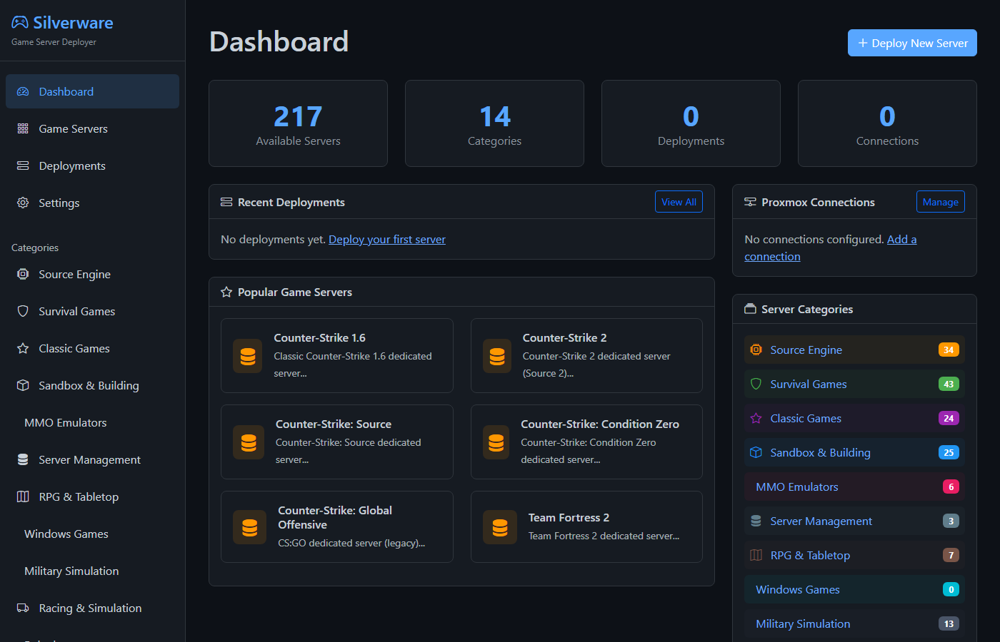
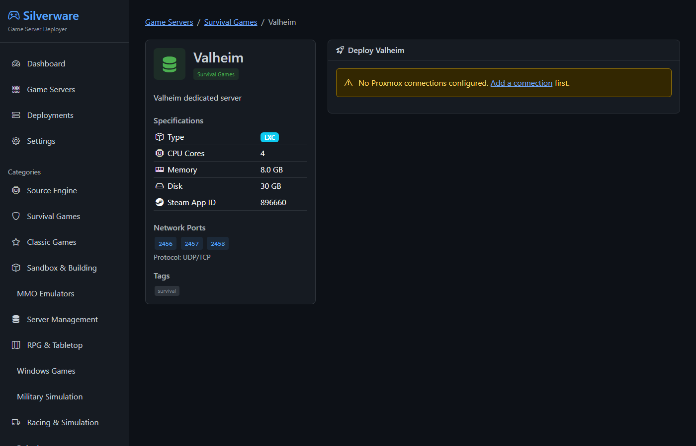
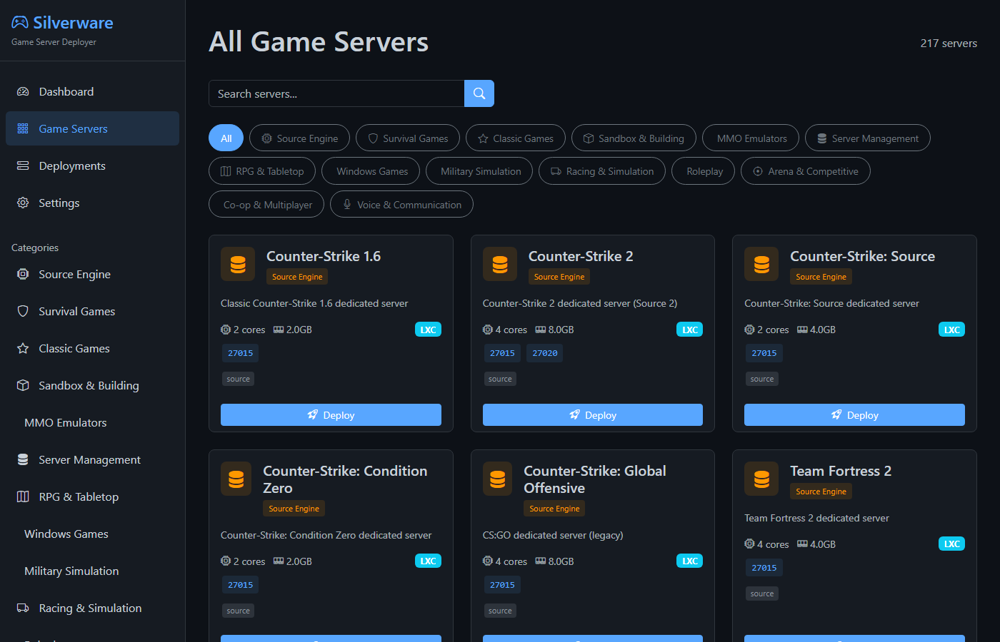

# Silverware Game Servers

A web app that deploys dedicated game servers to Proxmox VE as LXC containers, plus shell scripts and
Terraform/Packer templates for running the same servers without it.

## Status

**v0.1.0, alpha.** The web deployer's catalog lists 217 servers. 72 of them have an install script, so
the deployer creates the container *and* installs the game. The other 145 get a container sized for the
game and you install the game yourself. Every catalog entry deploys as an LXC container; VM deployment
exists in the code but no catalog entry uses it yet. See [docs/games.md](docs/games.md) for which is which.

The web UI has **no login**. Run it on a trusted network only; see [SECURITY.md](SECURITY.md).

## Screenshots

| Dashboard | Deploying a server |
|---|---|
|  |  |



## Getting Started

You need a Proxmox VE 7 or 8 host that you can reach on port 8006 (API) and port 22 (SSH; the deployer
runs the install script inside the container through `pct exec`). You also need an LXC template on that
host, for example Debian 12 or Ubuntu 22.04 (download it in the Proxmox UI: *local → CT Templates →
Templates*).

### Quick start (Docker)

1. Install [Docker Desktop](https://www.docker.com/products/docker-desktop) (Windows/macOS) or Docker
   Engine (Linux), and start it.
2. Download this repo ([zip](https://github.com/sp00nznet/gameservers/archive/refs/heads/main.zip)) and
   unzip it.
3. Start the deployer:
   - **Windows:** double-click `proxmox-deployer\start.bat`.
   - **Linux/macOS:** run `./proxmox-deployer/start.sh docker`.
4. Open <http://localhost:5555>. You should see the dashboard above, with "217 Available Servers".

The first start builds the image, which takes a minute or two. To stop it, run `stop.bat` or
`docker compose down` in `proxmox-deployer/`.

### Step by step (Python)

Prerequisites: Python 3.10 or newer (the Docker image uses 3.11; the tests run on 3.13).

```bash
git clone https://github.com/sp00nznet/gameservers.git
cd gameservers/proxmox-deployer
python3 -m venv venv
source venv/bin/activate          # Windows: venv\Scripts\activate
pip install -r requirements.txt
python run.py
```

Expected output:

```
 * Serving Flask app 'app'
 * Debug mode: off
WARNING: This is a development server. Do not use it in a production deployment. Use a production WSGI server instead.
 * Running on all addresses (0.0.0.0)
 * Running on http://127.0.0.1:5555
 * Running on http://<your LAN IP>:5555
Press CTRL+C to quit
```

It listens on every interface so other machines on your network can reach it. Set `FLASK_DEBUG=1`
for auto-reload and the debugger while developing (`./start.sh dev` does that).

Things that usually go wrong:
- **Windows: `python` opens the Microsoft Store.** Use `py` instead of `python3`, or turn off the
  alias in *Settings → Apps → Advanced app settings → App execution aliases*.
- **`ModuleNotFoundError: No module named 'flask_sqlalchemy'`.** The venv isn't active. Run the
  `activate` line again in the same window.

### First deploy

1. **Settings → Add Connection.** Enter the Proxmox host, port `8006`, user `root@pam` and its
   password. Provisioning needs the password because it logs in over SSH; an API token can create the
   container but can't run the install script.
2. **Test** the connection. It should report your Proxmox version.
3. **Game Servers → pick a game → Deploy.** Choose the node, storage, bridge and LXC template, then
   deploy. The deployer creates the container, starts it, and runs the install script if there is one.
   That can take several minutes for large Steam downloads.
4. **Deployments** shows the result. A failed install shows as `provision_failed` with the error; you
   can re-run the install with `POST /api/deployments/<id>/provision` (see [docs/api.md](docs/api.md)).

## Usage

Everything in the UI is also a JSON API (full list in [docs/api.md](docs/api.md)):

```bash
curl localhost:5555/api/stats
curl "localhost:5555/api/servers?search=valheim"
curl -X POST localhost:5555/api/deploy -H 'Content-Type: application/json' \
  -d '{"connection_id": 1, "server_key": "valheim", "node": "pve",
       "template": "local:vztmpl/debian-12-standard_12.7-1_amd64.tar.zst"}'
```

### Without the web deployer

- **Single Linux host:** `sudo ./setup.sh` opens a menu that installs one of the games with its own
  folder here (`teamfortress2/`, `projectzomboid/`, `azerothcore/`, ...) as a systemd service.
- **Terraform/Packer:** VM templates and per-game-type VM groups in `infrastructure/`; see
  [infrastructure/README.md](infrastructure/README.md).

### Docs

| Topic | File |
|---|---|
| How the pieces fit | [docs/architecture.md](docs/architecture.md) |
| Running, upgrading, backing up the deployer | [docs/running.md](docs/running.md) |
| REST API | [docs/api.md](docs/api.md) |
| Database tables | [docs/data-model.md](docs/data-model.md) |
| Every game, its ports and whether it auto-installs | [docs/games.md](docs/games.md) |
| Per-game settings | [docs/game-configuration.md](docs/game-configuration.md) |
| Ports to open | [docs/firewall.md](docs/firewall.md) |
| Troubleshooting | [docs/troubleshooting.md](docs/troubleshooting.md) |

## Building from source

There is nothing to compile. To build the Docker image and run the tests:

```bash
cd proxmox-deployer
docker build -t silverware-deployer .
pip install -r requirements.txt
python -m unittest discover tests
```

The tests render every page and run a deploy against a mocked Proxmox client, so they need no Proxmox
host. CI runs them on every push and pull request.

## Contributors

See [CONTRIBUTORS.md](CONTRIBUTORS.md). Contributions are welcome; read
[CONTRIBUTING.md](CONTRIBUTING.md) first.

## License

MIT, see [LICENSE](LICENSE). The game servers this installs are the property of their publishers and
are downloaded from their official sources (SteamCMD, LinuxGSM, Docker Hub) at install time; nothing
from them is in this repo.
