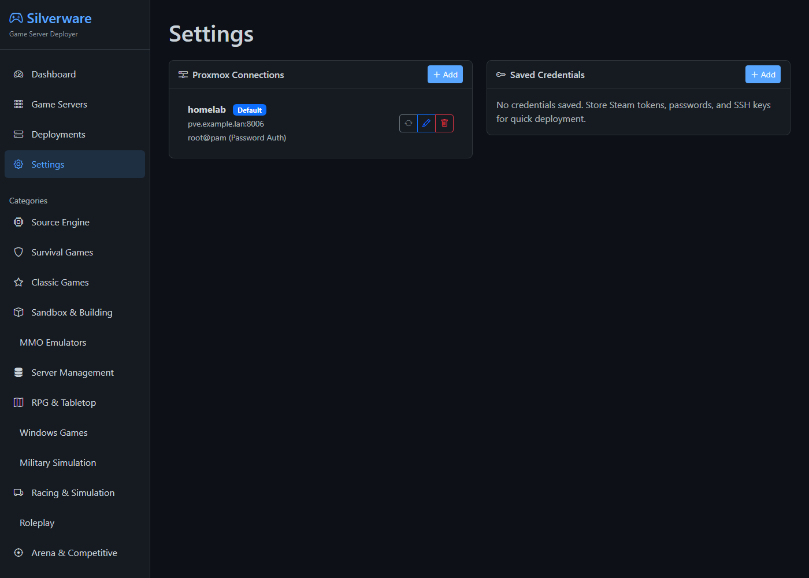

# Silverware Game Servers

A web app that deploys dedicated game servers to Proxmox VE as LXC containers, plus shell scripts and
Terraform/Packer templates for running the same servers without it.

## Status

**v0.1.0, alpha.** 217 games in the catalog; 72 install themselves after deploy, the rest get a
container sized for the game ([full list](docs/games.md)). LXC only for now. The web UI has **no
login**, so keep it on a trusted network ([SECURITY.md](SECURITY.md)).

## Screenshots

| Dashboard | Game catalog |
|---|---|
|  |  |
| **Deploying a server** | **Proxmox connections** |
|  |  |

## Getting Started

You need a Proxmox VE 7 or 8 host reachable on ports 8006 and 22, with an LXC template downloaded.

**Quick start (Docker):**

1. Install and start [Docker Desktop](https://www.docker.com/products/docker-desktop).
2. Download the [zip](https://github.com/sp00nznet/gameservers/archive/refs/heads/main.zip) and unzip it.
3. Double-click `proxmox-deployer\start.bat` (Linux/macOS: `./proxmox-deployer/start.sh docker`).
4. Open <http://localhost:5555>. The dashboard shows "217 Available Servers".

**Step by step (Python 3.10+):**

```bash
git clone https://github.com/sp00nznet/gameservers.git
cd gameservers/proxmox-deployer
python3 -m venv venv && source venv/bin/activate   # Windows: venv\Scripts\activate
pip install -r requirements.txt
python run.py                                      # → Running on http://127.0.0.1:5555
```

Then add your Proxmox host under **Settings** and deploy a game. The full guide covers expected
output, common mistakes, the first deploy, and running without the web app:
**[docs/getting-started.md](docs/getting-started.md)**.

## Usage

Everything in the UI is also a JSON API, e.g. `curl localhost:5555/api/stats`.

| Topic | Doc |
|---|---|
| Setup, first deploy, single-host scripts, Terraform | [getting-started.md](docs/getting-started.md) |
| Running, upgrading, backing up | [running.md](docs/running.md) |
| REST API with examples | [api.md](docs/api.md) |
| Every game and its ports | [games.md](docs/games.md) |
| Per-game settings | [game-configuration.md](docs/game-configuration.md) |
| Firewall ports | [firewall.md](docs/firewall.md) |
| Troubleshooting | [troubleshooting.md](docs/troubleshooting.md) |
| How it's built | [architecture.md](docs/architecture.md), [data-model.md](docs/data-model.md) |

## Building from source

Nothing to compile. Build the image and run the tests (no Proxmox needed; CI runs the same):

```bash
cd proxmox-deployer
docker build -t silverware-deployer .
python -m unittest discover tests
```

## Contributors

See [CONTRIBUTORS.md](CONTRIBUTORS.md) and [CONTRIBUTING.md](CONTRIBUTING.md).

## License

MIT, see [LICENSE](LICENSE). Game servers are downloaded from their official sources at install time;
none of their files are in this repo.
